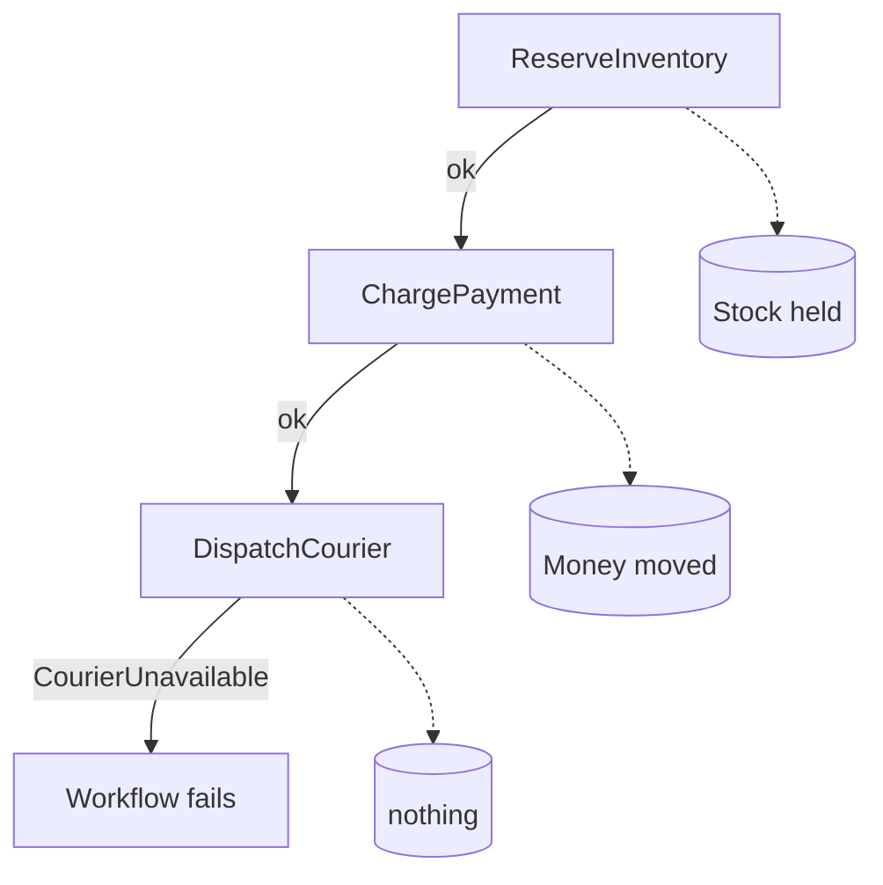

# The order that half-happened

Three systems changed. One of them said no.

<!--
Two minutes. No code yet.

Open with the concrete version, not the abstract one: an order comes in, the
stock is reserved, the card is charged, and the courier says there is nobody to
pick it up. Ask the room what their system does next. The honest answer in most
shops is "a ticket."
-->

---
layout: two-cols
---

# Three steps, three systems

Three services. Three effects you do not own:

- `ReserveInventory` — stock is held
- `ChargePayment` — money moves
- `DispatchCourier` — a pickup is booked

Step three fails. One and two already happened.

::right::

<!--
Source: the three forward Activities in
workshops/saga-order-fulfillment/solution/activities.go, and the
`FailDispatch` switch in order.go. This is exactly the `-fail-dispatch`
scenario they will run in about twenty minutes.

The dotted boxes are the point. Two effects landed outside the Workflow and one
did not, and the Workflow's own failure does nothing about any of them. Finish
the last line on the slide out loud: one and two already happened, and nothing
is going to take them back.

Say the customer-facing version of this out loud, because it is the sentence the
room will repeat to their own product owner: the card is charged for a parcel
that will never move.

The error type is real: `CourierUnavailable`, built with
`temporal.NewNonRetryableApplicationError` in `DispatchCourier`. Non-retryable
matters — this is not a blip that a retry will paper over, it is a business no.
Retries are not the answer to this slide, which is what makes it the right
opening for a room that already knows Temporal retries things.

Do not say "rollback" yet. Let someone in the room say it first.
-->

---
layout: default
---

# There is no `ROLLBACK`

A database transaction gives you atomicity because **one engine owns every write**.
It can throw the whole thing away because nothing left the building.

Across three services there is no engine, no shared log, and no undo:

- the warehouse committed its reservation and told its own downstream systems
- the gateway settled the charge and it is on a statement
- each service is behind an API that offers you a **new operation**, not a rewind

Durable execution guarantees your **orchestration** survives. It does not, and
cannot, un-charge a card.

<!--
This is the load-bearing slide of the opening block, and it is the one this
audience specifically needs, because they already trust Temporal to recover.

The trap for a team that knows Temporal well: durability of the Workflow gets
quietly read as durability of the *world*. It is not. Temporal will faithfully
replay you back to the exact moment after the money moved. The money is still
gone.

Say the consequence plainly: the undo is not infrastructure you can buy, it is
business logic somebody has to write. A refund is a business decision — which
account, what fee, what shows on the statement — and no platform can make it for
you.

If someone raises two-phase commit: ask whether the payment gateway will hold a
prepared transaction open across their courier's SLA. That ends the conversation
kindly, and it is the honest reason 2PC is not on this slide.
-->
