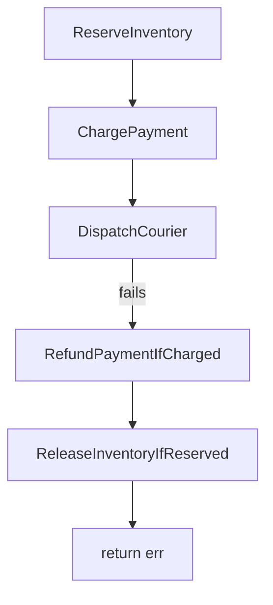

# Saga

Every step forward gets a step back.

<!--
Three minutes. This is the pattern block; the code comes next.

Name the pattern once and move: a Saga is a sequence of steps where each step
has a compensating action, and a failure runs the compensations for the steps
that already succeeded, in reverse.
-->

---
layout: two-cols
---

# Forward, then backward

Pair each forward step with the operation that undoes it:

| Step               | Undo                         |
| ------------------ | ---------------------------- |
| `ReserveInventory` | `ReleaseInventoryIfReserved` |
| `ChargePayment`    | `RefundPaymentIfCharged`     |
| `DispatchCourier`  | —                            |

On failure you run the undos for the steps that **actually ran**, newest first.

The last step needs no undo. Nothing came after it, so nothing depends on it.

::right::

<!--
Source: the five Activities in
workshops/saga-order-fulfillment/solution/activities.go. Read the names off
the slide — the `IfReserved` / `IfCharged` suffixes are deliberate and get their
own slide later. Do not explain them yet; if someone asks, say "hold that, it is
anti-pattern number two."

Why newest first, in one sentence: later steps were built on earlier ones, so
unwinding in the other direction can undo the foundation while something is
still standing on it. Refund the customer before you put the stock back — the
refund is the thing they are watching.

Reverse order is also the order that is easiest to reason about under a partial
failure, which is the real argument. You never have to ask whether step two's
undo is safe while step three's effect still exists, because step three's undo
already ran.
-->

---
layout: comparison
leftEyebrow: ONE DATABASE
leftTitle: Transaction
leftFeatures:
  - "Atomic — all writes or none"
  - "Rollback is free and automatic"
  - "Nothing is visible until commit"
  - "One engine owns the log"
rightEyebrow: MANY SERVICES
rightTitle: Saga
rightFeatures:
  - "Each step commits on its own"
  - "Undo is code you write"
  - "Intermediate states are visible"
  - "Your Workflow is the log"
---

The engine can discard uncommitted work because no one else ever saw it. You get
atomicity for free, and you get it only inside one boundary.

::right::

Semantic atomicity, not real atomicity. The order was reserved and charged for a
few hundred milliseconds and the world saw it. What you promise is that it does
not **stay** that way.

<!--
Source: the standard Saga definition (Garcia-Molina and Salem, 1987), stated in
the terms of the lab code rather than the paper.

The line to land is bottom right: a Saga does not give you atomicity, it gives
you eventual cleanliness. Anyone reading the inventory table mid-order sees the
reservation. That is not a bug in the pattern, it is the price of the pattern,
and a room running production Workflows will want that said out loud rather than
discovered later.

"Your Workflow is the log" is the sentence that earns Temporal its place here.
The compensation slice lives in Workflow state, which means it survives a Worker
dying mid-unwind: replay rebuilds it, append by append, from the Event History.
That is the part that is genuinely hard without durable execution, and the part
nobody has to write today.

If asked about isolation: yes, this is the classic Saga caveat, and the usual
answers are semantic locks or an explicit "pending" status on the record. Out of
scope for the lab, worth naming as real.
-->
